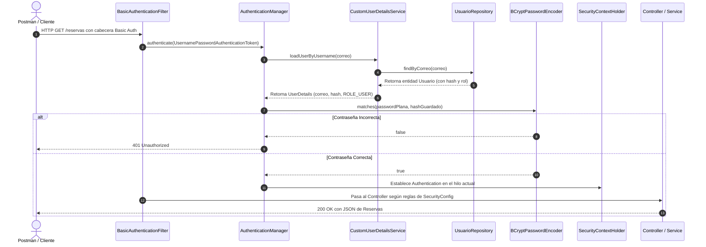

# Guía Maestra y Banco de Preguntas para la Defensa Oral
## Segundo Entregable - Lenguajes de Programación II (UCC - TUDS)

**Integrantes:**
- Ignacio Ortiz
- Leonardo Manrique
- Luis Poblete

---

## 1. Resumen Ejecutivo del Proyecto

- **Dominio:** Sistema RESTful para gestión de Usuarios y Reservas Gastronómicas.
- **Entidades:** `Usuario` (1) y `Reserva` (N) con relación real `@ManyToOne` / `findByUsuario_Id`.
- **Seguridad:**
  - Spring Security 6 / Spring Boot 3.2.5.
  - Autenticación **HTTP Basic** sin estado (`SessionCreationPolicy.STATELESS`).
  - Cifrado seguro de contraseñas con **BCrypt** (`PasswordEncoder`).
  - Control de acceso por roles (**RBAC**): `USER` (operaciones habituales) y `ADMIN` (permiso exclusivo de borrado `DELETE`).
  - Capas DTO y Mappers dedicados para garantizar la no exposición de contraseñas ni hashes en ningún endpoint (ni siquiera en entidades anidadas).
  - Manejo global de excepciones (`@RestControllerAdvice`) con códigos HTTP semánticos (`200`, `201`, `204`, `400`, `401`, `403`, `404`, `409`).

---

## 2. Conceptos Teóricos Fundamentales (La base de la evaluación)

### 2.1. Autenticación vs. Autorización
> [!IMPORTANT]
> Esta es **la pregunta obligatoria** indicada en la consigna: *"Cada integrante debe poder explicar su implementación y distinguir autenticación de autorización"*.

| Concepto | Definición | En nuestro proyecto | Código HTTP si falla |
|---|---|---|---|
| **Autenticación** | ¿Quién sos? Es el proceso de verificar la identidad del cliente mediante credenciales. | Se realiza en `CustomUserDetailsService` al buscar el correo y verificar la contraseña con `BCryptPasswordEncoder`. | `401 Unauthorized` |
| **Autorización** | ¿Qué podés hacer? Es el proceso de verificar si la identidad autenticada tiene permisos/roles para ejecutar una acción sobre un recurso. | Se define en `SecurityConfig` con `.requestMatchers(HttpMethod.DELETE, ...).hasRole("ADMIN")`. | `403 Forbidden` |

### 2.2. Basic Auth y Arquitectura Stateless
- **¿Qué es Basic Auth?** Es un mecanismo de autenticación HTTP estándar donde el cliente envía en cada petición la cabecera `Authorization: Basic <base64(usuario:contraseña)>`.
- **¿Por qué es Stateless (`SessionCreationPolicy.STATELESS`)?**
  - La API no almacena cookies de sesión (`JSESSIONID`) ni guarda estado en la memoria del servidor.
  - Cada petición es independiente y debe contener sus propias credenciales.
  - Esto facilita la escalabilidad horizontal y cumple con las buenas prácticas REST.
- **¿Base64 es cifrado?** **NO**. Base64 es una simple codificación reversible (cualquiera puede decodificarla). Por eso, en producción es obligatorio que viaje sobre **HTTPS (TLS/SSL)** para que el canal esté cifrado.

### 2.3. Hashing vs. Cifrado (BCrypt)
- **Cifrado (Encryption):** Es bidireccional (con una clave se cifra y con otra o la misma se descifra).
- **Hash (Hashing):** Es una función matemática unidireccional (irreversible). No se puede "deshashear" la contraseña.
- **¿Cómo valida Spring Security la contraseña entonces?**
  - No descifra la contraseña guardada en la base de datos.
  - Toma la contraseña en texto plano recibida en la petición, le aplica la misma función hash con el *salt* almacenado en el propio hash, y compara los hashes resultantes con `passwordEncoder.matches(rawPassword, encodedPassword)`.
- **¿Qué es el Salt?** Una cadena pseudoaleatoria que BCrypt genera automáticamente e inserta al inicio del hash (`$2a$10$...`). Evita ataques de fuerza bruta basados en tablas precalculadas (Rainbow Tables) y asegura que dos usuarios con la misma contraseña tengan hashes completamente diferentes.

---

## 3. Flujo Completo de una Petición en el Sistema



---

## 4. Banco Extenso de Preguntas y Respuestas para la Defensa

### Bloque A: Spring Security y Autenticación

#### P1. ¿Por qué implementaron `UserDetailsService` y no usaron usuarios en memoria?
**Respuesta:** Porque en una aplicación real los usuarios deben persistir en la base de datos. Implementamos `CustomUserDetailsService` para sobreescribir el método `loadUserByUsername(String username)`, buscando la entidad en `UsuarioRepository` por su correo electrónico. De esta manera, el usuario que se registra públicamente puede autenticarse de inmediato sin reiniciar la aplicación.

#### P2. ¿Cómo asocia Spring Security el rol del usuario con los permisos configurados?
**Respuesta:** En `CustomUserDetailsService`, convertimos el rol de la entidad (`Rol.USER` o `Rol.ADMIN`) en un objeto `SimpleGrantedAuthority` con el prefijo `"ROLE_"`, por ejemplo `new SimpleGrantedAuthority("ROLE_" + usuario.getRol().name())`. Luego, en `SecurityConfig`, cuando usamos `.hasRole("ADMIN")`, Spring Security automáticamente busca la autoridad `ROLE_ADMIN`.

#### P3. ¿Qué hace `csrf(AbstractHttpConfigurer::disable)` y por qué se desactiva?
**Respuesta:** CSRF (Cross-Site Request Forgery) es una vulnerabilidad asociada al uso de cookies de sesión en navegadores web. Al configurar la API como **Stateless** (sin sesiones HTTP ni cookies), y usando autenticación HTTP Basic orientada a clientes API (Postman, móviles o SPAs), el mecanismo CSRF no aplica y se deshabilita para permitir peticiones `POST`, `PUT` y `DELETE` sin necesidad de tokens anti-falsificación.

#### P4. ¿Qué pasa si un usuario envía la contraseña ya hasheada en el Basic Auth de Postman?
**Respuesta:** La autenticación fallará con `401 Unauthorized`. Basic Auth espera la contraseña en texto plano; Spring Security tomará esa cadena y la volverá a hashear con BCrypt. Si el usuario envía el hash, el sistema hasheará el hash, produciendo un valor totalmente diferente que nunca coincidirá.

#### P5. ¿Por qué habilitaron `headers.frameOptions(HeadersConfigurer.FrameOptionsConfig::disable)`?
**Respuesta:** Porque la consola web interactiva de la base de datos embebida H2 (`/h2-console`) se renderiza utilizando frames/iframes HTML. Spring Security por defecto bloquea el framing con la cabecera `X-Frame-Options: DENY` por seguridad (prevención de Clickjacking). Lo deshabilitamos puntualmente para permitir visualizar y consultar la base H2 en desarrollo.

---

### Bloque B: Autorización y Roles (RBAC)

#### P6. ¿Qué operación del dominio restringieron y a qué rol?
**Respuesta:** Restringimos la eliminación física de registros (`DELETE /usuarios/**` y `DELETE /reservas/**`) exclusivamente a usuarios con rol `ADMIN`. Los usuarios regulares con rol `USER` pueden registrarse, consultar y crear/modificar sus datos, pero si intentan eliminar un registro, el filtro de autorización rechaza la solicitud devolviendo `403 Forbidden`.

#### P7. ¿Cómo se previene que un usuario malicioso se registre a sí mismo como ADMIN?
**Respuesta:** Se previene desde la arquitectura de DTOs y Servicios:
1. El `UsuarioRegistroDTO` no contiene el atributo `rol`.
2. El mapper `UsuarioMapper` y el servicio `UsuarioService.registrar()` fijan por código y de forma estricta el rol `Rol.USER`.
De esta manera, aunque un cliente envíe `"rol": "ADMIN"` en el JSON, Jackson ignora el atributo o el mapper no lo toma, garantizando que todo registro público sea únicamente un usuario estándar.

#### P8. ¿Cómo crearon el usuario Administrador si el registro no lo permite?
**Respuesta:** Implementamos un componente `DataInitializer` que implementa `CommandLineRunner`. Al arrancar Spring Boot, este componente verifica si existe el usuario `admin@ucc.edu.ar`; si no existe, lo genera con rol `Rol.ADMIN` y su contraseña encriptada con BCrypt (`Admin123!`).

---

### Bloque C: Arquitectura, DTOs y Mappers

#### P9. ¿Por qué es una mala práctica exponer las entidades JPA directamente en los Controllers?
**Respuesta:**
1. **Seguridad / Data Leakage:** Exponer la entidad `Usuario` provocaría que el hash de la contraseña o datos sensibles viajen en las respuestas JSON hacia el cliente.
2. **Serialización cíclica:** Las relaciones bidireccionales (`@OneToMany` y `@ManyToOne`) provocan errores de bucles infinitos (`StackOverflowError`) con Jackson.
3. **Acoplamiento:** Cualquier cambio en la estructura de las tablas de la base de datos rompería el contrato público de la API REST.

#### P10. ¿Cómo garantizaron que la contraseña ni su hash aparezcan en las respuestas de Reservas?
**Respuesta:** Cuando se consulta una reserva (`ReservaResponseDTO`), este DTO contiene un objeto anidado de tipo `UsuarioResponseDTO` (generado por `UsuarioMapper`), el cual únicamente incluye `id`, `nombre`, `correo`, `edad` y `rol`. En ningún momento se transfiere el campo `password`. Además, como defensa en profundidad, en la entidad `Usuario` marcamos el atributo con `@JsonIgnore`.

---

### Bloque D: Persistencia y Relación JPA

#### P11. Expliquen la relación entre Usuario y Reserva.
**Respuesta:** Es una relación `@ManyToOne` en `Reserva` hacia `Usuario`. Múltiples reservas pueden pertenecer a un único usuario gastronómico. La tabla `reservas` almacena una clave foránea `usuario_id` que referencia a la clave primaria `id` de `usuarios`.

#### P12. ¿Cómo resolvieron la consulta requerida que utiliza esa relación?
**Respuesta:** En `ReservaRepository` definimos el método de consulta derivada:
```java
List<Reserva> findByUsuario_Id(Long usuarioId);
```
Spring Data JPA interpreta el nombre del método y genera automáticamente la consulta SQL con JOIN o filtrado por la clave foránea. Esto se expone en el endpoint `GET /reservas/usuario/{usuarioId}`, validando previamente que el usuario exista en el sistema.

#### P13. ¿Qué estrategia de generación de IDs utilizaron y por qué?
**Respuesta:** Utilizamos `@GeneratedValue(strategy = GenerationType.IDENTITY)`. Delegamos la asignación de claves primarias a la columna autoincremental nativa del motor de base de datos (`AUTO_INCREMENT` en MySQL y en H2), que es la práctica estándar en entornos relacionales.

---

### Bloque E: Manejo de Errores y Excepciones

#### P14. ¿Cómo manejan el intento de registrar un correo repetido?
**Respuesta:** Mediante una doble capa de protección:
1. **En la capa de servicio:** `UsuarioService` consulta `usuarioRepository.existsByCorreo(correo)` antes de guardar. Si ya existe, lanza una excepción propia: `CorreoYaExisteException`.
2. **En la base de datos:** La columna tiene `@Column(nullable = false, unique = true)`. Si por concurrencia fallara la validación lógica, la base dispara `DataIntegrityViolationException`.
Ambas excepciones son interceptadas por `GlobalExceptionHandler` (`@RestControllerAdvice`), devolviendo un status HTTP `409 Conflict` con un cuerpo JSON informativo (`ErrorDetalle`).

#### P15. ¿Cuál es la diferencia entre un error 400 y un error 404 en su API?
**Respuesta:**
- **400 Bad Request:** La sintaxis o los datos del JSON enviado son inválidos (por ejemplo, correo sin `@`, contraseña menor a 6 caracteres o edad negativa). Lo gestiona `MethodArgumentNotValidException` y `ValidacionException`.
- **404 Not Found:** La estructura de la petición es correcta, pero el recurso identificado por el ID no existe en la base de datos (por ejemplo, `GET /usuarios/999`). Lo gestiona `UsuarioNoEncontradoException` y `ReservaNoEncontradaException`.

---

### Bloque F: Preguntas Desafiantes / "Trampa" de Examen

#### P16. ¿Qué pasaría si cambiamos el `FetchType` de la relación `Reserva -> Usuario` a `LAZY`?
**Respuesta:** Si se utiliza `FetchType.LAZY` y se accede al usuario fuera de una transacción activa (`@Transactional`), Hibernate lanzaría una `LazyInitializationException` al intentar mapear `ReservaResponseDTO`. Como en nuestro caso el mapper convierte la reserva inmediatamente dentro del servicio transaccional (`reservaMapper.toResponseDTO(reserva)`), funcionaría correctamente, pero se debe tener precaución si la conversión ocurriera fuera de la transacción.

#### P17. ¿Por qué usamos `.trim().toLowerCase()` al validar y guardar correos?
**Respuesta:** Para normalizar el identificador unívoco. Si un usuario se registra con `Juan@Ucc.edu.ar` y luego intenta iniciar sesión con `juan@ucc.edu.ar`, podrían no coincidir si la base de datos o la comparación distinguieran mayúsculas y minúsculas (case sensitive). La normalización evita duplicados lógicos accidentales.

#### P18. ¿Cómo verificaron que las contraseñas en la base de datos realmente no son texto plano?
**Respuesta:** Se puede comprobar ingresando a la consola web H2 en `http://localhost:8080/h2-console` y ejecutando `SELECT * FROM USUARIOS;`. La columna `PASSWORD` muestra cadenas que inician con `$2a$10$....`. Asimismo, en la suite de tests automatizados, el test `caso7_revisarUsuarioGuardadoHashBCryptYSinExposicion` valida mediante aserciones de JUnit que el string comience con `$2a$` y no contenga la contraseña original.

---

## 5. Hoja de Ruta para la Demostración en Vivo (Live Demo con Postman)

Si la cátedra pide proyectar Postman y probar en vivo la API, sigan este orden exacto:

1. **Mostrar arranque de la aplicación:**
   - Ejecutar `.\mvnw.cmd spring-boot:run`.
   - Mostrar en el log de consola los mensajes de `DataInitializer` donde se inicializa el Admin y el User de prueba.
2. **Petición 1: Registro exitoso (201 Created)**
   - `POST /auth/registro` con `lucas.perez@example.com` y clave `Segura123!`.
   - Señalar que el JSON retornado tiene `id`, `rol: "USER"` y **ningún campo password**.
3. **Petición 2: Correo duplicado (409 Conflict)**
   - Reenviar la misma petición anterior.
   - Mostrar la respuesta `409 Conflict` con el mensaje claro de correo ya registrado.
4. **Petición 3: Validaciones fallidas (400 Bad Request)**
   - Enviar clave de 3 letras (`123`), correo inválido y edad `-5`.
   - Mostrar el array de errores detallados en el JSON.
5. **Petición 4: Acceso no autenticado (401 Unauthorized)**
   - `GET /reservas` sin Authorization header.
6. **Petición 5: Acceso autenticado USER (200 OK)**
   - `GET /reservas` con Basic Auth `user@ucc.edu.ar` / `User123!`.
7. **Petición 6: Operación prohibida a USER (403 Forbidden)**
   - `DELETE /usuarios/1` con credenciales de `user@ucc.edu.ar`.
   - Explicar la diferencia entre el 401 anterior (no autenticado) y este 403 (autenticado pero sin privilegios suficientes).
8. **Petición 7: Operación permitida a ADMIN (204 No Content)**
   - `DELETE /reservas/1` con credenciales de `admin@ucc.edu.ar` / `Admin123!`.
9. **Petición 8: Consulta por relación JPA (200 OK)**
   - `GET /reservas/usuario/2` demostrando la consulta derivada y que el usuario anidado tampoco expone credenciales.
